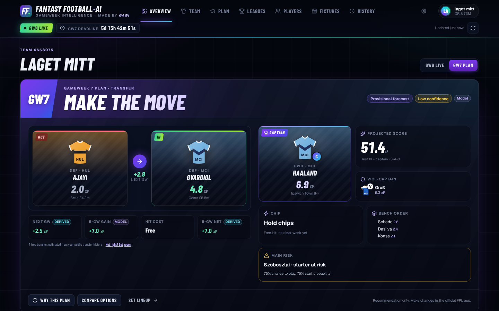
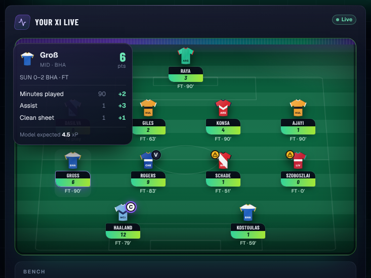
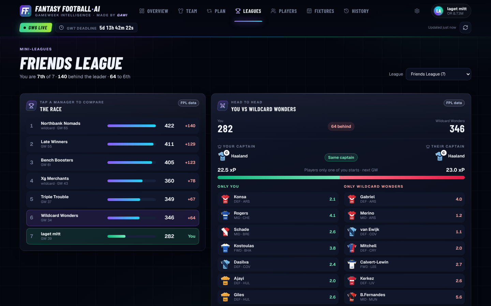
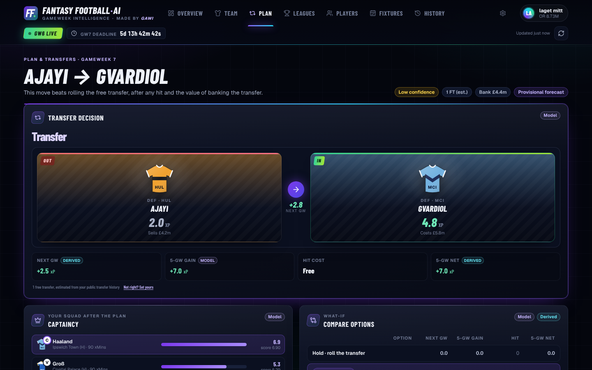
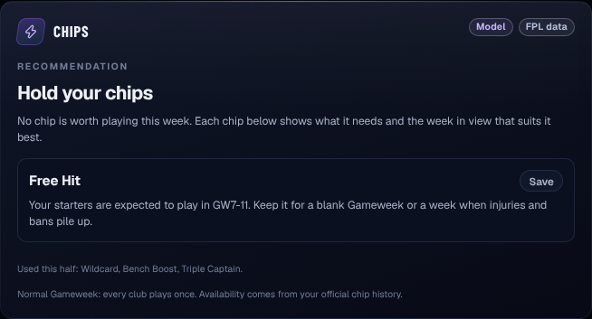
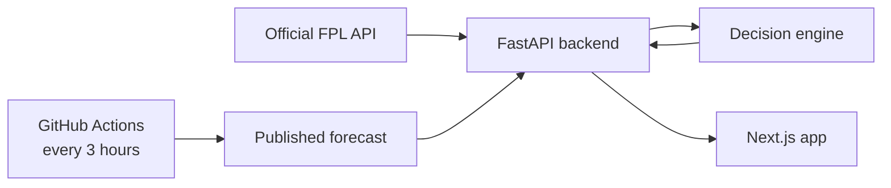

<div align="center">


# Fantasy Football AI

**Gameweek intelligence for Fantasy Premier League.**<br>
Transfers, captaincy, chips, live points and mini-leagues. One clear plan per deadline.

[**Open the app →**](https://fantasyfootball-ai.vercel.app)

[](https://github.com/GAWI01/fantasy-football-ai/actions/workflows/refresh-predictions.yml)

</div>



## What you get

Enter your public FPL Team ID. No login is needed, and the app never changes
your team.

| Feature | What it does |
|---|---|
| 🎯 **Gameweek plan** | Transfer or roll, captain and vice, bench order and the main risk, with a confidence level. The plan is ready as soon as the previous deadline passes. |
| 📡 **Live** | Live points against the model's expectation. Tap any player for their points breakdown. |
| 🔁 **Transfers** | Every option compared on one scale, plus **Test your own move**: is your idea better than the plan? |
| 🃏 **Chips** | Play now or save, and the best week for each chip you still have. |
| 🏆 **Mini-leagues** | The race, a head-to-head against any rival, and the players your league relies on. |
| 📊 **Research** | Your team on a pitch, every player's forecast, fixture runs and a season review against the model. |

<table>
  <tr>
    <td width="50%"></td>
    <td width="50%"></td>
  </tr>
  <tr>
    <td align="center"><b>Live</b>: points per player, per stat</td>
    <td align="center"><b>Mini-leagues</b>: the race and your rival</td>
  </tr>
  <tr>
    <td></td>
    <td></td>
  </tr>
  <tr>
    <td align="center"><b>Transfers</b>: the move and why</td>
    <td align="center"><b>Chips</b>: when each one pays off</td>
  </tr>
</table>

**[See every feature with screenshots →](docs/FEATURES.md)**

## How it works



- **Forecast:** a gradient-boosting model of each player's points. It
  beats a last-five average on unseen Gameweeks (mean absolute error 1.26
  against 1.35) and is re-checked after every Gameweek.
- **Decisions:** one optimiser picks the squad, XI and captain over five
  weighted Gameweeks. Holding, free transfers and hits are scored on one
  scale.
- **Honest labels:** every number is marked FPL data, Model or Derived, and
  uncertainty is shown, never hidden.

More detail: [architecture](docs/ARCHITECTURE.md) ·
[model](docs/MODEL_PIPELINE.md) · [API](docs/API.md)

## Run it locally

```bash
git clone https://github.com/GAWI01/fantasy-football-ai.git
cd fantasy-football-ai
docker compose up --build        # app on :3000, API on :8000
```

<details>
<summary>Without Docker (Python 3.12+, Node.js 22+)</summary>

```bash
python -m venv .venv && source .venv/bin/activate
python -m pip install -r requirements.txt -r backend/requirements.txt
python -m uvicorn backend.main:app --reload --port 8000
```

In a second terminal:

```bash
cd frontend
corepack enable && pnpm install --frozen-lockfile
cp ../.env.example .env.local
pnpm dev
```

| Variable | Purpose | Default |
|---|---|---|
| `NEXT_PUBLIC_API_URL` | Backend origin, compiled into the app | `http://127.0.0.1:8000` |
| `FPL_AI_CORS_ORIGINS` | App origins the API accepts | `http://localhost:3000,http://127.0.0.1:3000` |

</details>

<details>
<summary>Tests</summary>

```bash
python -m pytest                 # backend, decision engine, model pipeline
python -m benchmark.run          # decision benchmark on recorded real teams
cd frontend && pnpm test && pnpm lint && pnpm exec tsc --noEmit
```

</details>

## Docs

| Doc | What's inside |
|---|---|
| [Features](docs/FEATURES.md) | Every page and what each number means |
| [Architecture](docs/ARCHITECTURE.md) | Backend, decision engine, forecasts, repository map |
| [Model](docs/MODEL_PIPELINE.md) | Training, certification and limitations |
| [API](docs/API.md) | Every endpoint |
| [Deployment](docs/DEPLOYMENT.md) | Railway and Vercel; merging to `master` deploys |
| [App icon](docs/APP_ICON.md) | How to swap the icon |
| [Data sources](docs/DATA_SOURCES.md) | Where the data comes from, the conditions and personal data |
| [Data notice](DATA_NOTICE.md) | Who owns the data, and how to ask for removal |
| [Privacy and terms](https://fantasyfootball-ai.vercel.app/privacy) | The public privacy notice and terms of use |
| [Contributing](.github/CONTRIBUTING.md) | How to propose a change, and the data and privacy rules |
| [Security](.github/SECURITY.md) | How to report a vulnerability privately |

## Data and credits

- **Historical data:** the model is trained on past FPL seasons from
  [**vaastav/Fantasy-Premier-League**](https://github.com/vaastav/Fantasy-Premier-League)
  by Vaastav Anand, used with his permission and this attribution. Thank you!
- **Live data:** the public Fantasy Premier League API.

---

<sub>Free, independent and non-commercial. Not affiliated with or endorsed by
the Premier League or Fantasy Premier League. FPL data, names and marks belong
to their owners. Code under the [MIT licence](LICENSE); data is not covered,
see [DATA_NOTICE.md](DATA_NOTICE.md). Made by [GAWI01](https://github.com/GAWI01).</sub>
