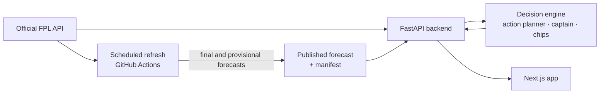

# Fantasy Football AI

**Gameweek intelligence for Fantasy Premier League managers.** Enter your
public Team ID and get one clear plan for the next deadline: whether to
transfer or roll, who to captain, which chip to save or play and how your
squad looks over the next five Gameweeks. While a Gameweek is live, follow
your points player by player and see how you stand in your mini-leagues.
Everything comes from a validated points model and the official FPL data.

**Live app:** [fantasyfootball-ai.vercel.app](https://fantasyfootball-ai.vercel.app)

[](https://github.com/GAWI01/fantasy-football-ai/actions/workflows/refresh-predictions.yml)

> Free, independent, non-commercial beta. Not affiliated with or endorsed by
> the Premier League or Fantasy Premier League. Recommendations only: make
> your changes in the official FPL app. The app never logs in to FPL and never
> changes your team.


## Contents

- [Features](#features)
  - [Gameweek plan](#gameweek-plan)
  - [Live Gameweek](#live-gameweek)
  - [Plan & Transfers](#plan--transfers)
  - [Chips](#chips)
  - [Mini-leagues](#mini-leagues)
  - [My Team](#my-team)
  - [Players and Fixtures](#players-and-fixtures)
  - [History & Review](#history--review)
  - [On a phone](#on-a-phone)
- [Trust: what every number means](#trust-what-every-number-means)
- [How it works](#how-it-works)
- [The decision engine](#the-decision-engine)
- [The model](#the-model)
- [API](#api)
- [Run it locally](#run-it-locally)
- [Tests and benchmark](#tests-and-benchmark)
- [Repository](#repository)
- [Deployment](#deployment)
- [Data and rights](#data-and-rights)

## Features

### Gameweek plan

The Overview shows one recommendation for the next deadline:

- **The move:** one transfer, several transfers, a hit, or **hold and roll the
  free transfer**. Holding is a real option with a value, so the app does not
  spend free transfers just because you have them.
- **Captain and vice**, picked from the squad you will have *after* the
  recommended transfers. The app never captains a player it tells you to sell.
  When two captains are within 0.3 xP of each other, the surer starter wins.
- **Projected score** of the best XI plus captain, the **bench order** and the
  **main risk** in your XI (doubtful players, rotation, minutes).
- **Chip call:** play or save, with the best week for each chip you still
  have. See [Chips](#chips).
- **Confidence:** how clearly the chosen action beats the next-best one,
  measured against the projection uncertainty of the players involved. It is
  *Unknown* when that uncertainty is not available.

**Planning during a live Gameweek.** As soon as a deadline passes, the next
Gameweek's forecast is published as a *provisional forecast*, built on history
up to the Gameweek before. You can therefore plan GW7 while GW6 is still being
played. The plan is labelled **Provisional forecast** until the live Gameweek
has final scores and the forecast is replaced. During a live Gameweek the
Overview has a **GW6 live / GW7 plan** switch.

### Live Gameweek


- **Live points** for your active picks against the model's expectation saved
  before the deadline. Official multipliers apply: captain, Triple Captain,
  Bench Boost and vice-captain cover.
- **Progress:** how many starters have played, are playing or are still to
  play. Full time counts as played: FPL's own `finished` flag waits for a data
  check that can take hours.
- **Your matches** with live scores, **what is happening** (top contributor,
  who is left to play, auto-sub watch for starters on 0 minutes) and **owned
  player returns**, with one row per player.


**Live stats card.** Hover over a player on the live pitch with a mouse, or tap
them on a phone, and a glass card opens with FPL's official points breakdown.
It lists minutes, goals, assists, clean sheet, saves, bonus, cards and
defensive contributions, the points each one earned, the match score and the
model's expectation. The rows add up to the player's official total.

### Plan & Transfers


The Plan page explains the recommendation in full:

- **Transfer decision:** who goes out, who comes in, the selling and buying
  prices, and four numbers:
  - **Next GW:** the gain for the coming Gameweek;
  - **5-GW gain:** the gain over five weighted Gameweeks;
  - **Hit cost;**
  - **5-GW net:** the gain minus any hit.
- **Captaincy** from the squad after the plan, with each option's projected
  points and expected minutes.
- **Compare options:** hold, the recommendation, the best moves with and
  without a hit, and the multi-transfer options. Every option is on the same
  scale. Tap an option to see its moves next to the recommendation.
- **Squad outlook:** a five-Gameweek heat map of every player's projected
  points, opponents and blanks.
- **Why this plan:** the reasons, the confidence, and how to read every number.
- **Minutes risk** and a **plan history** remembered in your browser.

<table>
  <tr>
    <td width="50%"></td>
    <td width="50%"></td>
  </tr>
  <tr>
    <td><b>Compare options</b>: every option on one scale.</td>
    <td><b>Test your own move</b>: is your idea better than the plan?</td>
  </tr>
</table>

**Test your own move.** Pick a player to sell and one to buy, and the engine
scores your move exactly like its own plan: the same horizon, prices, lineup
and captain. You get a plain verdict, such as "Better than holding by 1.4,
but 3.6 below the recommended plan", plus the gains and the hit cost. Illegal
moves (budget, three players per club, position) are explained, not scored.

**Budgets you can trust.** FPL does not publish selling prices. The app derives
them from your public transfer history: purchase price plus half of any rise,
rounded down. A price is labelled as an estimate only when it cannot be traced.
You can also set your free transfers yourself if the derived number is wrong.

### Chips


For every chip you still have, the app says **Play now** or **Save**, and
points at the week in the five-Gameweek view that suits it best for your
squad:

| Chip | Worth playing when | Best week in view |
|---|---|---|
| **Wildcard** | A rebuild beats your best normal move by the planner's threshold | — |
| **Free Hit** | A blank Gameweek where a one-week team gains at least 8 points | The week with the most starters without a match or ruled out (at least 3) |
| **Bench Boost** | A double Gameweek with at least 12 projected bench points | The week your bench projects the most, with doubles counted |
| **Triple Captain** | A double Gameweek with a captain projected for at least 9 points | The week your best captain projects the most |

A chip is never recommended just because it is available. When a blank or
double Gameweek is announced, or injuries pile up in one week, that week
appears automatically. The Overview's chip tile shows a one-line summary,
such as "Free Hit: best GW9".

### Mini-leagues


Every private classic league you are in, from public FPL data:

- **The race:** standings as bars, with each manager's gap to you, Gameweek
  score and active chip. One line sums up your position: "You are 7th of 7 ·
  140 behind the leader · 64 to 6th".
- **Head to head:** you against any rival. By default this is the manager
  directly above you. It shows:
  - the points gap;
  - both captains;
  - the players only one of you starts, with their next-Gameweek projection;
  - a bar showing whose unique players are projected to score more.
- **Radar:** the league's **threats** and your **differentials**, based on
  effective ownership (a captain counts twice, a bench player not at all).
  - A threat is a player at least half your rivals rely on and you do not own.
  - A differential is a starter of yours under 25% rival ownership.

FPL publishes squads only after a deadline, so mini-leagues use the latest
squads whose deadline has passed and say so. In large leagues the top 30
managers are analysed, plus you.

*The manager and team names in this screenshot are anonymised.*

### My Team


Your squad on a pitch with each player's forecast for the next Gameweek, or
their live points during one. Drag or tap players to test lineups, bench order
and armbands: formations always stay legal, and **Apply model XI** sets the
best lineup in one tap. Your edits stay in the app; set your real team in FPL.
Tap a player for the full detail: price, form, ownership, expected minutes,
injury news and the five-Gameweek outlook.

### Players and Fixtures

<table>
  <tr>
    <td width="50%"></td>
    <td width="50%"></td>
  </tr>
  <tr>
    <td><b>Players</b>: every player's official stats, next-GW forecast, expected minutes, xP per £m and next three fixtures. Search, filter, sort and compare players side by side.</td>
    <td><b>Fixtures</b>: every club's next 3, 5 or 8 Gameweeks with official difficulty, blanks and doubles, ranked from easiest to hardest.</td>
  </tr>
</table>

### History & Review


- **Season record:** total points, overall rank and its trend, average and best
  Gameweek, transfers made, and rank and points charts.
- **Gameweek review:** your official score against the forecast that was saved
  *before* that deadline, never one rebuilt afterwards. It covers:
  - your captain;
  - decision quality, judged on the pre-deadline projections only, so luck
    does not count;
  - bench points;
  - each transfer's projected and actual gain;
  - the biggest model miss and the biggest minutes miss;
  - every pick, player by player.
- Wildcard weeks show your **net squad changes**: a chain of swaps
  (A→B, then B→C) becomes one change (A→C), with the same totals.
- The page opens on the latest Gameweek that has a saved pre-deadline forecast.

### On a phone

<table>
  <tr>
    <td align="center"></td>
    <td align="center"></td>
  </tr>
  <tr>
    <td align="center"><b>Overview</b> on a phone.</td>
    <td align="center"><b>Mini-leagues</b> on a phone.</td>
  </tr>
</table>

The whole app is designed for phones as well: a bottom tab bar, tap instead of
hover, and no sideways scrolling.

## Trust: what every number means

Every number is labelled by where it comes from:

- **Official:** straight from FPL.
- **Model:** the forecast.
- **Derived:** calculated from official data and the forecast.

When something is uncertain, the app says so instead of hiding it:

- estimated selling prices or free transfers;
- a provisional forecast;
- unknown confidence;
- forecasts that are missing for a Gameweek;
- players flagged by official injury news.

An unknown Team ID gets a clear "not found" message. A forecast is shown only
for the Gameweek it was made for.

## How it works



- **Backend** (`backend/`, FastAPI):
  - reads public FPL data at request time through a cached, rate-limited
    gateway;
  - applies the latest official availability, prices and names to the
    forecast;
  - runs the decision engine and caches its results, so a repeat dashboard
    request takes about 0.5 s.

  No FPL login or API key is needed.
- **Decision engine** (`optimizer/action_planner.py`, `transfer_analysis.py`,
  `decision_engine.py`, `decision_intelligence.py`, `decision_strategy.py`):
  one canonical action per Gameweek. See below.
- **Frontend** (`frontend/`, Next.js 16, React 19): the responsive app shown
  above.
- **Forecasts** (`historical_data/`): a scheduled workflow refreshes official
  data every three hours.
  - As soon as a deadline passes, it publishes a provisional forecast for the
    next Gameweek.
  - It replaces that forecast once the live Gameweek has final scores.
  - After every Gameweek it scores the forecast against the final points.

  It commits to `master`, which deploys the API (Railway) and the app (Vercel).

## The decision engine

The planner (`optimizer/action_planner.py`) solves one mixed-integer program
with SciPy/HiGHS. It chooses:

- the squad;
- the starters for each Gameweek;
- the captain for each Gameweek.

It optimises them together over a five-Gameweek horizon. Later weeks count
less: the weights are 1, 0.85, 0.7, 0.55 and 0.4.

- **Holding/rolling,** each number of free transfers and up to two hits are
  compared on one scale: the best XI and captain each plan can field, minus
  hits and the value of the free transfers it uses.
- **A banked transfer has a value,** so a move must beat rolling it.
- **Bench players count only as autosub cover** (10%, goalkeeper 2%), so the
  engine does not buy a reserve goalkeeper for his points.
- **A hit costs 4 points plus a safety margin.** The engine takes one only
  when the five-Gameweek gain clearly pays for it.
- **Availability is applied per Gameweek.** Official news such as "Suspended
  until …" or "Expected back …" means a one-match ban costs one Gameweek, not
  five.
- **Actions are labelled honestly:** HOLD, SINGLE_TRANSFER, MULTI_TRANSFER or
  HIT. A chip is recommended only on evidence.

A replay benchmark (`benchmark/`) runs the engine on recorded real teams and
checks the plans for consistency. For example, no transfers of a bench
goalkeeper, no captain the plan sells and no automatic wildcards. Root causes
and results are in [docs/audit/](docs/audit/).

## The model

The forecast is a gradient-boosting model of each player's points per fixture
(`models/fpl_model_v4.pkl`). Its inputs are:

- the player's last five completed Gameweeks: points, minutes, starts, goals,
  assists, BPS and ICT;
- how many of those Gameweeks exist yet;
- price and position;
- home or away;
- the official fixture difficulty.

Training, validation and live forecasting share one feature implementation,
so live inputs are computed exactly as in training.

It was trained on 2020-21 to 2025-26 and certified on the current season's
completed Gameweeks (2026-27 GW1–5), which it never saw:

| At certification (October 2026) | Mean abs. error | RMSE | Points of its top 10 per GW |
|---|---|---|---|
| **Model** | **1.256** | **2.230** | **6.06** |
| Baseline: last-five average | 1.350 | 2.650 | 3.46 |

A model is certified only if all of these hold:

- it beats that baseline;
- its features provably ignore results from the Gameweek being forecast;
- the live path reproduces the validation inputs exactly.

After every Gameweek the forecast is scored against the final points
(`historical_data/current_data/forecast_checks.csv`), so drift shows up within
a week.

Forecasts are expected points, not guarantees, and one player's Gameweek is
very random. The five-Gameweek outlook takes the model's points if the player
is available and scales them by each fixture's difficulty; it does not
forecast each week separately. The method, limitations and commands are in
[docs/MODEL_PIPELINE.md](docs/MODEL_PIPELINE.md).

## API

All endpoints are read-only and use public FPL data. Each response is an
envelope: `{ data, meta, errors }`, where `meta` carries the source,
freshness and version.

| Endpoint | Returns |
|---|---|
| `GET /health` | `{"status":"ok"}` |
| `GET /api/v1/status` | Forecast and official Gameweek state, and whether they match |
| `GET /api/v1/dashboard/{team_id}` | Squad, decision, intelligence (captain, chips, chip outlook, horizon), live Gameweek and history |
| `GET /api/v1/plan/{team_id}` | The decision alone |
| `GET /api/v1/evaluate/{team_id}?sell=…&buy=…` | Your own transfers scored against holding and the recommendation |
| `GET /api/v1/leagues/{team_id}` | The manager's private classic leagues |
| `GET /api/v1/league/{league_id}?team_id=…` | Standings, gaps, effective ownership, threats and differentials |
| `GET /api/v1/league/{league_id}/rival/{rival_id}?team_id=…` | Head to head: shared and unique players, captains |
| `GET /api/v1/players` | Every player with official stats and the forecast |
| `GET /api/v1/fixtures`, `GET /api/v1/fixture-matrix` | Fixtures and fixture runs with difficulty |
| `GET /api/v1/review/{team_id}?event=…` | A finished Gameweek against its pre-deadline forecast |

Interactive documentation is at `http://localhost:8000/docs` when running
locally.

## Run it locally

You need the numeric Team ID from your FPL URL, e.g.
`https://fantasy.premierleague.com/entry/1234567/event/1`.

**Docker Compose** (backend on port 8000, app on port 3000):

```bash
git clone https://github.com/GAWI01/fantasy-football-ai.git
cd fantasy-football-ai
docker compose up --build
```

**Development servers** (Python 3.12+, Node.js 22+, pnpm via Corepack):

```bash
python -m venv .venv
source .venv/bin/activate        # Windows: .\.venv\Scripts\Activate.ps1
python -m pip install -r requirements.txt -r backend/requirements.txt
python -m uvicorn backend.main:app --reload --port 8000
```

In a second terminal:

```bash
cd frontend
corepack enable
pnpm install --frozen-lockfile
cp ../.env.example .env.local    # Windows: Copy-Item ..\.env.example .env.local
pnpm dev
```

Open `http://localhost:3000`. The API answers `{"status":"ok"}` at
`http://localhost:8000/health`. `/api/v1/status` reports whether the forecast
matches the official next Gameweek.

| Variable | Purpose | Local default |
|---|---|---|
| `NEXT_PUBLIC_API_URL` | Backend origin, compiled into the app | `http://127.0.0.1:8000` |
| `FPL_AI_CORS_ORIGINS` | App origins the API accepts | `http://localhost:3000,http://127.0.0.1:3000` |

## Tests and benchmark

```bash
python -m pytest                         # backend, decision engine, model pipeline
python -m benchmark.run                  # decision benchmark on recorded real teams
cd frontend && pnpm test && pnpm lint && pnpm exec tsc --noEmit
```

To refresh data and publish a due forecast by hand, run
`python -m historical_data.refresh_predictions`. The scheduled workflow can
also be started from the Actions tab. To retrain and recertify the model, run
`python -m historical_data.validate_model`.

## Repository

| Path | Contents |
|---|---|
| `frontend/` | Next.js app: pages in `app/`, features in `components/`, view models in `lib/model/` |
| `backend/` | FastAPI API, FPL gateway, live, league, selling-price, availability and review services |
| `optimizer/` | Action planner (MILP), lineup and chip optimisation |
| `decision_*.py`, `transfer_analysis.py` | Decision engine: plan, captain, confidence, chips, horizon and risk |
| `historical_data/` | Season data, feature building, training, validation and forecast publishing |
| `models/` | The certified model with its validation report and certificate |
| `benchmark/` | Replay harness and decision benchmark on recorded real teams |
| `tests/`, `backend/tests/` | Python test suites |
| `docs/` | Model pipeline, deployment, data sources, audits and screenshots |

## Deployment

Merging to `master` deploys automatically:

- Railway builds the API from `Dockerfile.backend`, using the allowlist in
  `.dockerignore`.
- Vercel builds the app from `frontend/`.

See [docs/DEPLOYMENT.md](docs/DEPLOYMENT.md).

## Data and rights

Live data comes from the public Fantasy Premier League API. Historical seasons
come from [vaastav/Fantasy-Premier-League](https://github.com/vaastav/Fantasy-Premier-League).
FPL and Premier League data, names and marks belong to their owners. This
project is free and non-commercial; see [docs/DATA_SOURCES.md](docs/DATA_SOURCES.md)
and the conditions in [docs/DATA_USE_RELEASE_GATE.md](docs/DATA_USE_RELEASE_GATE.md).

Made by [GAWI01](https://github.com/GAWI01).
