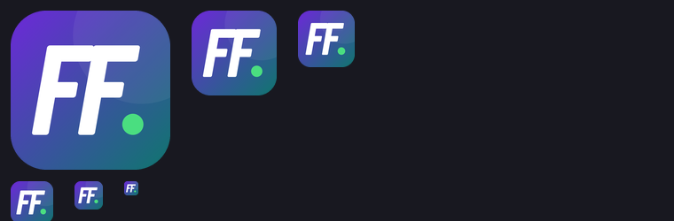

# App icon

Back to the [README](../README.md).



The logo is an italic **FF** monogram with the green dot of "FF.AI", on the
brand's violet-to-teal gradient. It is designed as a vector in
`frontend/brand/app-icon.svg`:

- It is a full-bleed square. iOS and Android round the corners themselves.
- All artwork stays inside the central 80%, the Android "maskable" safe zone.
- It reads at every size down to a 16 px favicon.

## Changing the icon

1. Edit `frontend/brand/app-icon.svg`, or design a new 1024×1024 image.
2. Export it to a 1024×1024 PNG. Use any vector tool, or open the SVG in a
   browser and save a screenshot.
3. Regenerate every icon:

   ```bash
   python scripts/generate_icons.py path/to/new-icon.png
   ```

   This copies the PNG to `frontend/brand/app-icon-source.png` and rewrites:

   | File | Use |
   |---|---|
   | `frontend/app/favicon.ico` (16/32/48), `frontend/app/icon.png` (32) | Browser tab |
   | `frontend/app/apple-icon.png` (180) | iPhone home screen |
   | `frontend/public/icons/icon-192.png`, `icon-512.png`, `icon-maskable-512.png` | Install / Android, listed in `frontend/app/manifest.ts` |
   | `frontend/public/icons/logo-mark.png` (128) | The logo in the app header |

4. Check the contact sheet in `frontend/brand/icon-preview.png`, then commit.

If you use a detailed illustration rather than a simple mark, set `MARK_BOX`
at the top of the script to a tight crop of its main subject for the small
sizes. If its artwork reaches the edges, set `SOURCE_IS_MASKABLE = False`.

Pillow is required (`python -m pip install pillow`).

An icon already saved to an iPhone home screen keeps the old image. Remove
it and add it again (Share → Add to Home Screen) to get the new one.
