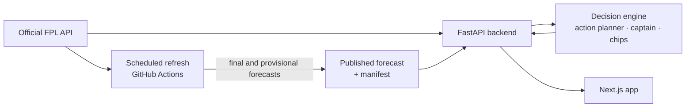

# Architecture

How the app, the API, the decision engine and the forecasts fit together. Back to the [README](../README.md).

## How it works

- **Backend** (`backend/`, FastAPI):
  - reads public FPL data at request time through a cached, rate-limited
    gateway;
  - applies the latest official availability, prices and names to the
    forecast;
  - runs the decision engine and caches its results, so a repeat dashboard
    request takes about 0.5 s.

  No FPL login or API key is needed.
- **Decision engine** (`optimizer/action_planner.py`, `transfer_analysis.py`,
  `decision_engine.py`, `decision_intelligence.py`, `decision_strategy.py`):
  one canonical action per Gameweek. See below.
- **Frontend** (`frontend/`, Next.js 16, React 19): the responsive app shown
  above.
- **Forecasts** (`historical_data/`): a scheduled workflow refreshes official
  data every three hours.
  - As soon as a deadline passes, it publishes a provisional forecast for the
    next Gameweek.
  - It replaces that forecast once the live Gameweek has final scores.
  - After every Gameweek it scores the forecast against the final points.

  It commits to `master`, which deploys the API (Railway) and the app (Vercel).

## The decision engine

The planner (`optimizer/action_planner.py`) solves one mixed-integer program
with SciPy/HiGHS. It chooses:

- the squad;
- the starters for each Gameweek;
- the captain for each Gameweek.

It optimises them together over a five-Gameweek horizon. Later weeks count
less: the weights are 1, 0.85, 0.7, 0.55 and 0.4.

- **Holding/rolling,** each number of free transfers and up to two hits are
  compared on one scale: the best XI and captain each plan can field, minus
  hits and the value of the free transfers it uses.
- **A banked transfer has a value,** so a move must beat rolling it.
- **Bench players count only as autosub cover** (10%, goalkeeper 2%), so the
  engine does not buy a reserve goalkeeper for his points.
- **A hit costs 4 points plus a safety margin.** The engine takes one only
  when the five-Gameweek gain clearly pays for it.
- **Availability is applied per Gameweek.** Official news such as "Suspended
  until …" or "Expected back …" means a one-match ban costs one Gameweek, not
  five.
- **Actions are labelled honestly:** HOLD, SINGLE_TRANSFER, MULTI_TRANSFER or
  HIT. A chip is recommended only on evidence.

A replay benchmark (`benchmark/`) runs the engine on recorded real teams and
checks the plans for consistency. For example, no transfers of a bench
goalkeeper, no captain the plan sells and no automatic wildcards. Root causes
and results are in [audit/](audit/).

## The model

The forecast is a gradient-boosting model of each player's points per fixture
(`models/fpl_model_v4.pkl`). Its inputs are:

- the player's last five completed Gameweeks: points, minutes, starts, goals,
  assists, BPS and ICT;
- how many of those Gameweeks exist yet;
- price and position;
- home or away;
- the official fixture difficulty.

Training, validation and live forecasting share one feature implementation,
so live inputs are computed exactly as in training.

It was trained on 2020-21 to 2025-26 and certified on the current season's
completed Gameweeks (2026-27 GW1–5), which it never saw:

| At certification (October 2026) | Mean abs. error | RMSE | Points of its top 10 per GW |
|---|---|---|---|
| **Model** | **1.256** | **2.230** | **6.06** |
| Baseline: last-five average | 1.350 | 2.650 | 3.46 |

A model is certified only if all of these hold:

- it beats that baseline;
- its features provably ignore results from the Gameweek being forecast;
- the live path reproduces the validation inputs exactly.

After every Gameweek the forecast is scored against the final points
(`historical_data/current_data/forecast_checks.csv`), so drift shows up within
a week.

Forecasts are expected points, not guarantees, and one player's Gameweek is
very random. The five-Gameweek outlook takes the model's points if the player
is available and scales them by each fixture's difficulty; it does not
forecast each week separately. The method, limitations and commands are in
[docs/MODEL_PIPELINE.md](MODEL_PIPELINE.md).

## Repository

| Path | Contents |
|---|---|
| `frontend/` | Next.js app: pages in `app/`, features in `components/`, view models in `lib/model/` |
| `backend/` | FastAPI API, FPL gateway, live, league, selling-price, availability and review services |
| `optimizer/` | Action planner (MILP), lineup and chip optimisation |
| `decision_*.py`, `transfer_analysis.py` | Decision engine: plan, captain, confidence, chips, horizon and risk |
| `historical_data/` | Season data, feature building, training, validation and forecast publishing |
| `models/` | The certified model with its validation report and certificate |
| `benchmark/` | Replay harness and decision benchmark on recorded real teams |
| `tests/`, `backend/tests/` | Python test suites |
| `docs/` | Model pipeline, deployment, data sources, audits and screenshots |
