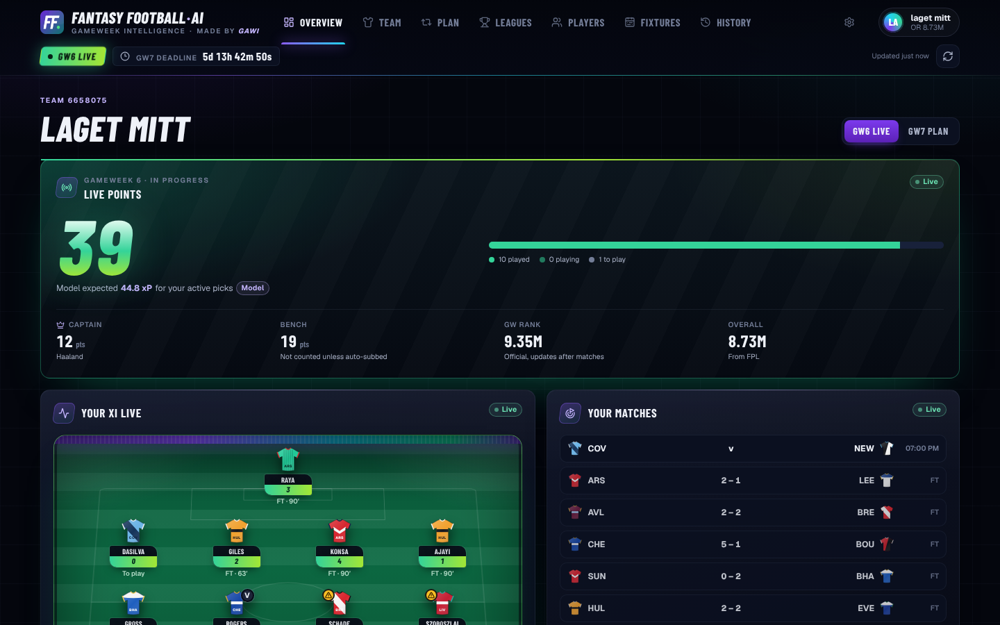
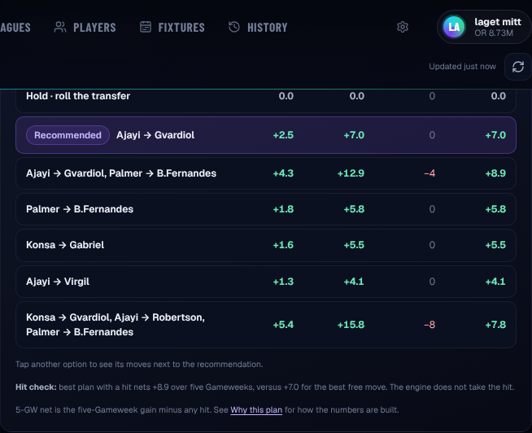
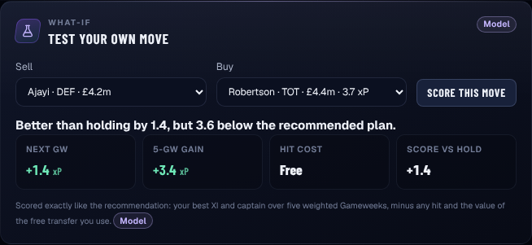
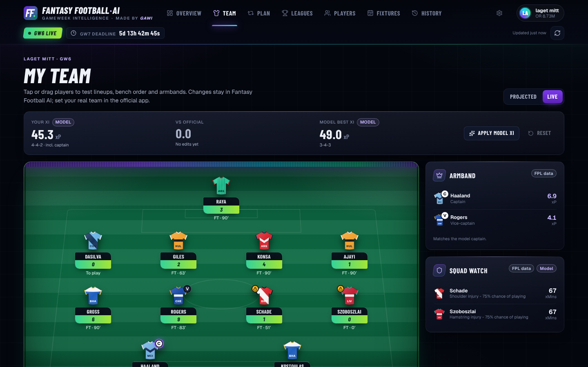
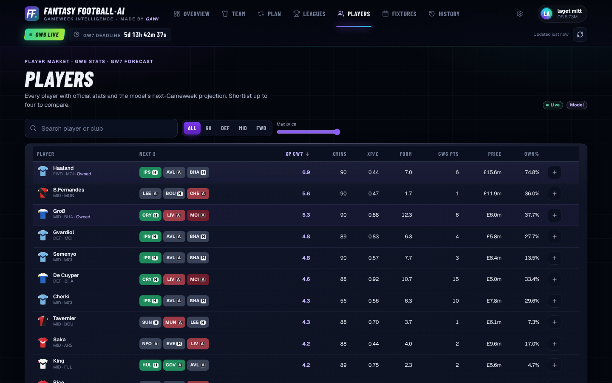
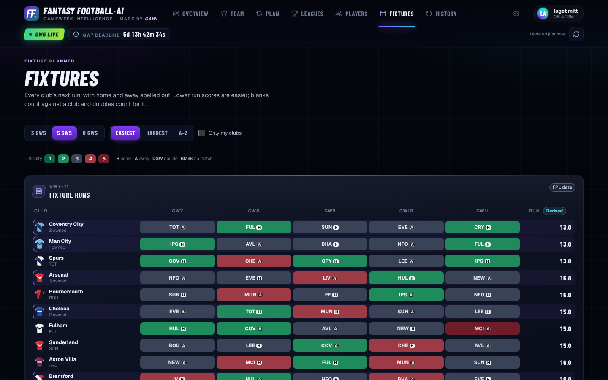
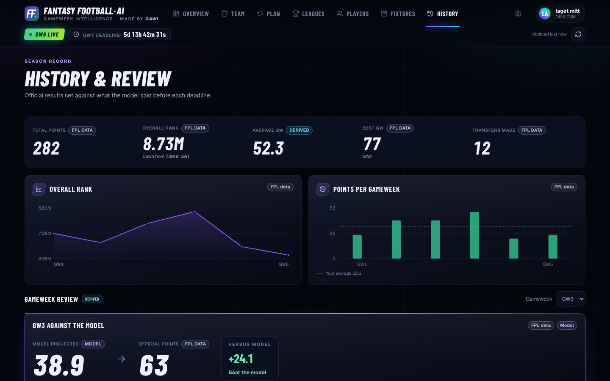
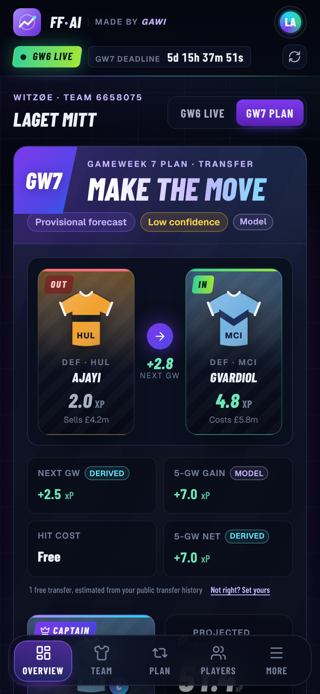
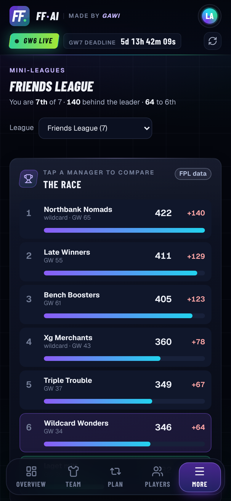

# Features

A tour of everything Fantasy Football AI does. Back to the [README](../README.md).

## Gameweek plan

The Overview shows one recommendation for the next deadline:

- **The move:** one transfer, several transfers, a hit, or **hold and roll the
  free transfer**. Holding is a real option with a value, so the app does not
  spend free transfers just because you have them.
- **Captain and vice**, picked from the squad you will have *after* the
  recommended transfers. The app never captains a player it tells you to sell.
  When two captains are within 0.3 xP of each other, the surer starter wins.
- **Projected score** of the best XI plus captain, the **bench order** and the
  **main risk** in your XI (doubtful players, rotation, minutes).
- **Chip call:** play or save, with the best week for each chip you still
  have. See [Chips](#chips).
- **Confidence:** how clearly the chosen action beats the next-best one,
  measured against the projection uncertainty of the players involved. It is
  *Unknown* when that uncertainty is not available.

**Planning during a live Gameweek.** As soon as a deadline passes, the next
Gameweek's forecast is published as a *provisional forecast*, built on history
up to the Gameweek before. You can therefore plan GW7 while GW6 is still being
played. The plan is labelled **Provisional forecast** until the live Gameweek
has final scores and the forecast is replaced. During a live Gameweek the
Overview has a **GW6 live / GW7 plan** switch.

**Decision first.** The Overview opens with the call itself: the move, the
numbers behind it, and one line each for the captain, the main risk and the
chip. Everything else sits in sections below it that open and close from their
header: **Lineup & captain** (the model XI, bench order, captain and vice),
**What changed**, **Chip**, **Season** and **Your fixture runs**. A closed
section shows a one-line summary. On a phone the sections start closed, on a
desktop most start open, and the app remembers what you open or close. Something
new opens its section by itself until you close it: a changed plan, a chip to
play now, or a possible auto-sub during a live Gameweek. While a Gameweek is
live, a line at the top links the live cockpit and the next Gameweek's plan.

## Live Gameweek

- **Live points** for your active picks against the model's expectation saved
  before the deadline. Official multipliers apply: captain, Triple Captain,
  Bench Boost and vice-captain cover.
- **Progress:** how many starters have played, are playing or are still to
  play. Full time counts as played: FPL's own `finished` flag waits for a data
  check that can take hours.
- **Your matches** with live scores, **what is happening** (top contributor,
  who is left to play, auto-sub watch for starters on 0 minutes) and **owned
  player returns**, with one row per player.

**Live stats card.** Hover over a player on the live pitch with a mouse, or tap
them on a phone, and a glass card opens with FPL's official points breakdown.
It lists minutes, goals, assists, clean sheet, saves, bonus, cards and
defensive contributions, the points each one earned, the match score and the
model's expectation. The rows add up to the player's official total.

## Plan & Transfers

The Plan page explains the recommendation in full:

- **Transfer decision:** who goes out, who comes in, the selling and buying
  prices, and four numbers:
  - **Next GW:** the gain for the coming Gameweek;
  - **5-GW gain:** the gain over five weighted Gameweeks;
  - **Hit cost;**
  - **5-GW net:** the gain minus any hit.
- **Captaincy** from the squad after the plan, with each option's projected
  points and expected minutes.
- **Compare options:** hold, the recommendation, the best moves with and
  without a hit, and the multi-transfer options. Every option is on the same
  scale. Tap an option to see its moves next to the recommendation.
- **Squad outlook:** a five-Gameweek heat map of every player's projected
  points, opponents and blanks.
- **Why this plan:** the reasons, the confidence, and how to read every number.
- **Minutes risk** and a **plan history** remembered in your browser.

<table>
  <tr>
    <td width="50%"></td>
    <td width="50%"></td>
  </tr>
  <tr>
    <td><b>Compare options</b>: every option on one scale.</td>
    <td><b>Test your own move</b>: is your idea better than the plan?</td>
  </tr>
</table>

**Test your own move.** Pick a player to sell and one to buy, and the engine
scores your move exactly like its own plan: the same horizon, prices, lineup
and captain. You get a plain verdict, such as "Better than holding by 1.4,
but 3.6 below the recommended plan", plus the gains and the hit cost. Illegal
moves (budget, three players per club, position) are explained, not scored.

**Budgets you can trust.** FPL does not publish selling prices. The app derives
them from your public transfer history: purchase price plus half of any rise,
rounded down. A price is labelled as an estimate only when it cannot be traced.
You can also set your free transfers yourself if the derived number is wrong.

## Chips

For every chip you still have, the app says **Play now** or **Save**, and
points at the week in the five-Gameweek view that suits it best for your
squad:

| Chip | Worth playing when | Best week in view |
|---|---|---|
| **Wildcard** | A rebuild beats your best normal move by the planner's threshold | — |
| **Free Hit** | A blank Gameweek where a one-week team gains at least 8 points | The week with the most starters without a match or ruled out (at least 3) |
| **Bench Boost** | A double Gameweek with at least 12 projected bench points | The week your bench projects the most, with doubles counted |
| **Triple Captain** | A double Gameweek with a captain projected for at least 9 points | The week your best captain projects the most |

A chip is never recommended just because it is available. When a blank or
double Gameweek is announced, or injuries pile up in one week, that week
appears automatically. The Overview's chip tile shows a one-line summary,
such as "Free Hit: best GW9".

## Mini-leagues

Every private classic league you are in, from public FPL data:

- **The race:** standings as bars, with each manager's gap to you, Gameweek
  score and active chip. One line sums up your position: "You are 7th of 7 ·
  140 behind the leader · 64 to 6th".
- **Head to head:** you against any rival. By default this is the manager
  directly above you. It shows:
  - the points gap;
  - both captains;
  - the players only one of you starts, with their next-Gameweek projection;
  - a bar showing whose unique players are projected to score more.
- **Radar:** the league's **threats** and your **differentials**, based on
  effective ownership (a captain counts twice, a bench player not at all).
  - A threat is a player at least half your rivals rely on and you do not own.
  - A differential is a starter of yours under 25% rival ownership.

FPL publishes squads only after a deadline, so mini-leagues use the latest
squads whose deadline has passed and say so. In large leagues the top 30
managers are analysed, plus you.

*The team names in this screenshot are anonymised.*

## My Team

Your squad on a pitch with each player's forecast for the next Gameweek, or
their live points during one. Drag or tap players to test lineups, bench order
and armbands: formations always stay legal, and **Apply model XI** sets the
best lineup in one tap. Your edits stay in the app; set your real team in FPL.
Tap a player for the full detail: price, form, ownership, expected minutes,
injury news and the five-Gameweek outlook.

## Players and Fixtures

<table>
  <tr>
    <td width="50%"></td>
    <td width="50%"></td>
  </tr>
  <tr>
    <td><b>Players</b>: every player's official stats, next-GW forecast, expected minutes, xP per £m and next three fixtures. Search, filter, sort and compare players side by side.</td>
    <td><b>Fixtures</b>: every club's next 3, 5 or 8 Gameweeks with official difficulty, blanks and doubles, ranked from easiest to hardest.</td>
  </tr>
</table>

## History & Review

- **Season record:** total points, overall rank and its trend, average and best
  Gameweek, transfers made, and rank and points charts.
- **Gameweek review:** your official score against the forecast that was saved
  *before* that deadline, never one rebuilt afterwards. It covers:
  - your captain;
  - decision quality, judged on the pre-deadline projections only, so luck
    does not count;
  - bench points;
  - each transfer's projected and actual gain;
  - the biggest model miss and the biggest minutes miss;
  - every pick, player by player.
- Wildcard weeks show your **net squad changes**: a chain of swaps
  (A→B, then B→C) becomes one change (A→C), with the same totals.
- The page opens on the latest Gameweek that has a saved pre-deadline forecast.

## On a phone

<table>
  <tr>
    <td align="center"></td>
    <td align="center"></td>
  </tr>
  <tr>
    <td align="center"><b>Overview</b> on a phone.</td>
    <td align="center"><b>Mini-leagues</b> on a phone.</td>
  </tr>
</table>

The whole app is designed for phones as well: a bottom tab bar, tap instead of
hover, controls at least 40px tall, text at least 12px, and no sideways
scrolling.

## Look and motion

The app is meant to feel alive during a Gameweek, without getting in the way.

- **Background:** soft violet, teal and green light drifts behind the glass
  cards like floodlights on a night pitch. It turns greener while a Gameweek is
  live, warms towards amber in the last 24 hours before a deadline, and swells
  green when one of your players scores.
- **Moments:** when one of your players scores or assists, a short notice
  slides in and the player pops on the pitch. Live points count up, and a
  number that changes glows once. Goals are noticed when the live data
  refreshes (every minute), so a notice can arrive up to a minute late.
- **Settings → Motion:** Auto (the default), Calm (moves only at moments),
  Lively, Max or Off. Your device's reduce-motion setting always wins.

## Trust: what every number means

Every number's source is labelled, once per card:

- **FPL data:** straight from the official game. The app itself is independent, not official.
- **Model:** the forecast.
- **Derived:** calculated from official data and the forecast.

When something is uncertain, the app says so instead of hiding it:

- estimated selling prices or free transfers;
- a provisional forecast;
- unknown confidence;
- forecasts that are missing for a Gameweek;
- players flagged by official injury news.

An unknown Team ID gets a clear "not found" message. A forecast is shown only
for the Gameweek it was made for.
